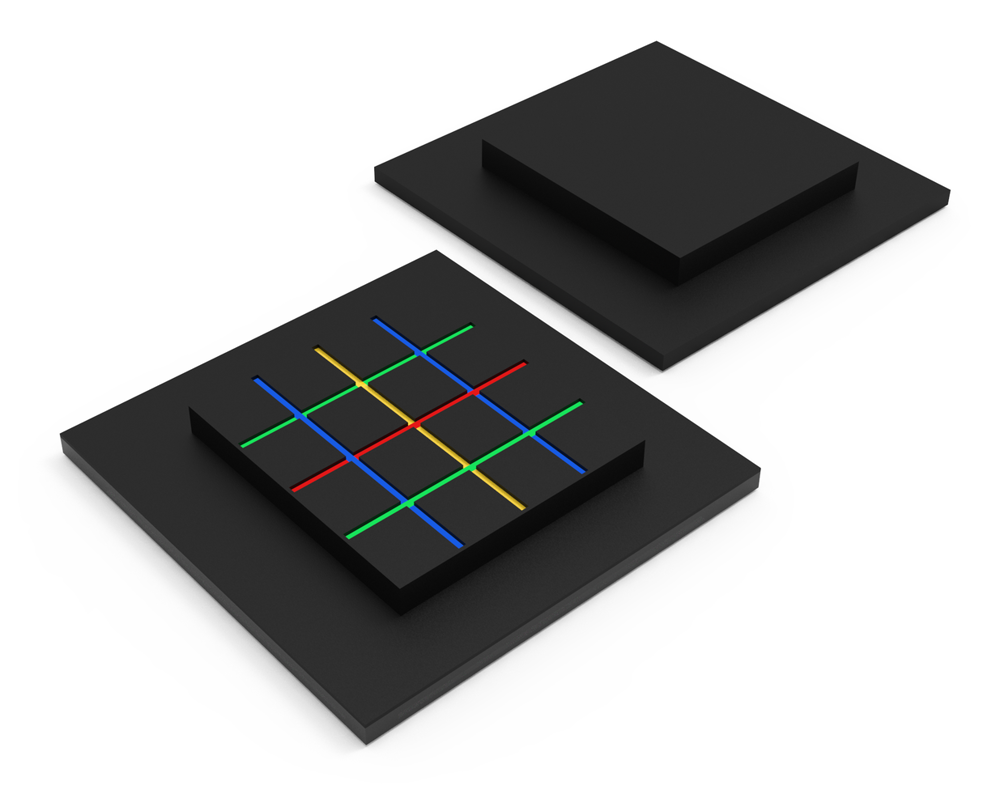
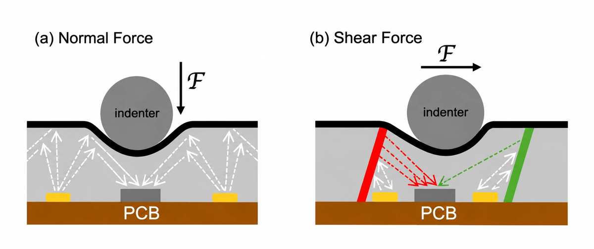
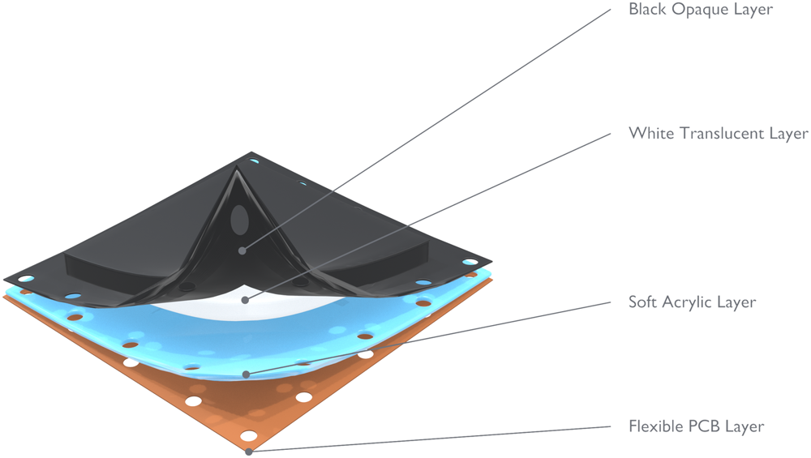
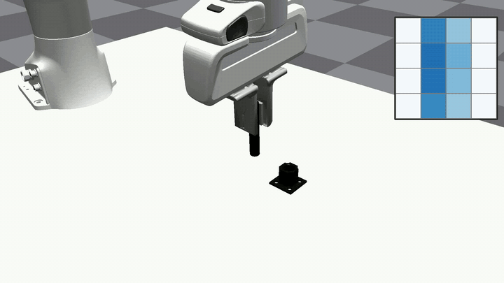
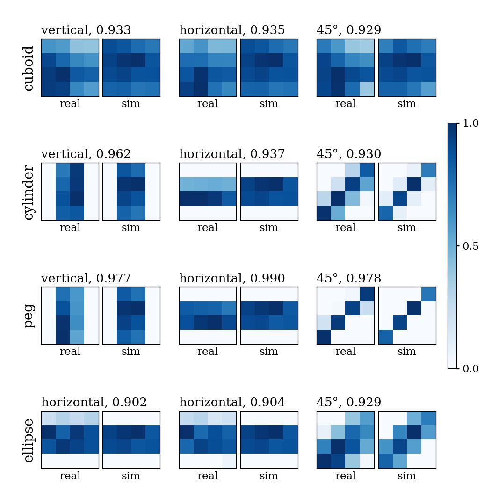

<div align="center">

<picture>
  <source media="(prefers-color-scheme: dark)" srcset="media/title_dark.png">
  
</picture>

<h3>An Optical Taxel Array</h3>

<a href="https://luxtac.github.io/"></a>

<p>
<b>Simulation of the LuxTac optical taxel array</b>
</p>



</div>

LuxTac is a scalable optical taxel array. Each taxel is a digital light-to-digital
converter that observes LED light back-scattered from a white translucent silicone
layer capped by a black opaque layer. Pressing thins the layer, so the reading falls
with local indentation depth.

<p align="center">


</p>

This repository simulates the 4x4 pad in IsaacGym with TacSL. Each taxel reads its
penetration depth into the object, and a per-taxel map fitted to the real sensor's
calibration presses turns that depth into the signal the real pad would report.

<p align="center">

<br>
<em>Simulated peg insertion. The grid is the left pad's 4x4 reading.</em>
</p>

**Contents:** [Installation](#1-installation) · [Look at the pad](#2-look-at-the-pad) ·
[Sim-to-real comparison](#3-sim-to-real-comparison) ·
[Teleoperation](#4-teleoperation-and-data-collection) ·
[Policy training](#5-policy-training) · [Layout](#6-repository-layout)

---

## 1. Installation

```bash
git clone https://github.com/AdeeshDesai/LuxTac-Sim.git
cd LuxTac-Sim
bash install.sh
conda activate luxtac
```

The installation script will:
- Check for conda/mamba, and install Miniforge3 if not found
- Create a Python 3.8 environment named `luxtac`
- Download and install IsaacGym TacSL
- Clone and install luxtac-isaacgymenvs (IsaacGymEnvs + TacSL)
- Install LuxTac and its dependencies
- Deploy the LuxTac sensor, task and asset files into luxtac-isaacgymenvs

The dependencies land in `thirdparty/`, which git does not track:
```
LuxTac-Sim/
├── luxtac/                  # pad model, calibration, config, envs, teleop demo
├── isaacgymenvs/            # task class deployed into luxtac-isaacgymenvs
├── assets/  scripts/  alignment/
└── thirdparty/
    ├── luxtac-isaacgymenvs/              # IsaacGymEnvs + TacSL
    └── IsaacGym_Preview_TacSL_Package/   # Isaac Gym binary (TacSL build)
```

If the Isaac Gym download fails, get the archive from
[here](https://drive.google.com/file/d/13dFRF9EXpzIWaJF2Z6f7BsuPUGQkPE8v/view), save it as
`thirdparty/IsaacGym_Preview_TacSL_Package.tar.gz` and run `install.sh` again.

Verify the installation:

```bash
conda activate luxtac
export LD_LIBRARY_PATH=${CONDA_PREFIX}/lib:${LD_LIBRARY_PATH}
python -c "from isaacgym import gymtorch"
./scripts/run_view_luxtac.sh --object peg_vert --once --headless
```

`install.sh` reads three optional environment variables: `LUXTAC_ENV_NAME` (environment
name, default `luxtac`), `LUXTAC_IGE_URL` (URL or local path to clone luxtac-isaacgymenvs
from) and `CI=true` (no prompts).

The deploy step copies new, luxtac-named files into the luxtac-isaacgymenvs clone and
edits none of its existing files. After changing anything under `luxtac/`, `isaacgymenvs/`
or `assets/`, run it again:

```bash
./scripts/deploy.sh
```

The launchers in `scripts/` read two optional environment variables:

| variable | meaning | default |
|---|---|---|
| `IGE_DIR` | the luxtac-isaacgymenvs clone LuxTac was deployed into | `thirdparty/luxtac-isaacgymenvs` |
| `CONDA_ENV` | path of the Python environment | the `luxtac` conda environment |

Only one Isaac Gym process can use a GPU at a time.

---

## 2. Look at the pad

```bash
./scripts/run_view_luxtac.sh --object peg_vert      # live per-taxel readout, gripper on the keyboard
```

Objects: `{cuboid,cylinder,ellipse,peg}_{vert,horz,deg45,deg135}`.

In the viewer, `c` / `o` close and open the gripper by 0.10 mm (`C` / `O` by 0.50 mm);
the terminal must have focus. Teleop is described in section 4.

---

## 3. Sim-to-real comparison

<p align="center">

<br>
<em>Measured (left of each pair) and simulated (right) readings, with the cosine of each grasp.</em>
</p>

`alignment/` holds the real grasps and the simulated ones, so the comparison runs
without a GPU:

```bash
python alignment/compare.py
```

```
matched simulation                    0.942   (median 0.934, lowest grasp 0.902)
real frames of the same hold          0.9994
uniform pad                           0.763
simulation of a different object      0.674
same object, different orientation    0.642
matched simulation, taxels shuffled   0.594
45 deg, correct / mirrored diagonal   0.946 / 0.264
one-to-one assignment, object         10 / 12
Wasserstein-1 of pooled values        0.067
```

---

## 4. Teleoperation and data collection

SpaceMouse teleop on an insertion task, with the live pad viewer. Every episode is
recorded.

```bash
./scripts/run_teleop_luxtac.sh --object peg_insert --indent 6.0   # peg-in-hole: 15 mm peg, 16 mm socket
./scripts/run_teleop_luxtac.sh --object usb --indent 3.0          # USB plug and socket
```

| input | action |
|---|---|
| SpaceMouse | move the arm |
| LEFT / RIGHT arrow | close / open the gripper |
| `d` | save the episode and start the next |
| `r` | discard the episode and retry |
| `q` | quit (the unfinished episode is dropped) |

The simulator window must have focus for the keys. `--indent` sets how far the
gripper is commanded into the object, in mm; raise it if the pads read nothing.
`--no-record` runs live only. If one axis moves the wrong way, set the three signs
with `--sm-sign`, e.g. `--sm-sign=+--`.

Episodes are appended to a zarr replay buffer in `data/teleop/<object>/` (override
with `--out`):

| path | contents |
|---|---|
| `replay_buffer.zarr/data/<key>` | every step of every episode, back to back: `action`, `luxtac_left`, `luxtac_right` (4x4), `luxtac_depth_left`, `luxtac_depth_right` (4x4, metres), `front`, `wrist` (256x256x3, float in [0, 1]), `ee_pos`, `ee_quat`, `socket_pos`, `socket_quat`, `finger_dof`, `hand_pos`, `step_idx`, `t` |
| `replay_buffer.zarr/meta/episode_ends` | index one past the last step of each episode |

---

## 5. Policy training

Coming soon.

---

## 6. Repository layout

| path | contents |
|---|---|
| `luxtac/` | pad model (sampling lattice, photodiode response), calibration fits and data, the environment wrapper, and `luxtac/config/` with the hydra config and task yamls |
| `isaacgymenvs/tasks/tacsl/` | the task class (deployed into the same path of luxtac-isaacgymenvs) |
| `assets/` | gripper URDF, the 16 test objects, the insertion peg and socket, and the object tables the task reads at run time |
| `scripts/` | deploy, sweep, hold, viewer and teleop launchers, object generator |
| `luxtac/demo/` | teleop and episode recorder |
| `alignment/` | `compare.py`, the real grasps (`real/`) and the simulated sweeps and holds (`sim/`) |
| `media/` | images for this page |
| `thirdparty/` | dependencies, filled in by `install.sh` |

Regenerate the objects with
`python scripts/make_luxtac_objs.py assets/luxtac/mesh assets/luxtac/urdf`.

Copyright (c) 2025 The LuxTac authors. Released under
[CC BY-NC-SA 4.0](https://creativecommons.org/licenses/by-nc-sa/4.0/) (`LICENSE`) for
non-commercial use; for commercial use, contact Purdue Innovates. Third-party parts keep
their own licences, listed in `THIRD_PARTY_NOTICES.md`.
